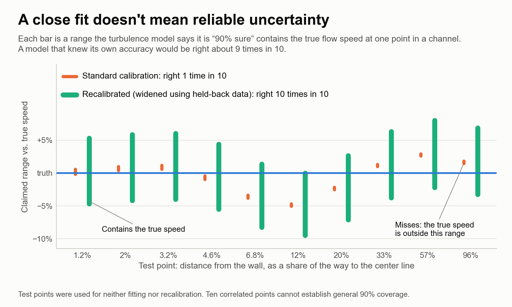
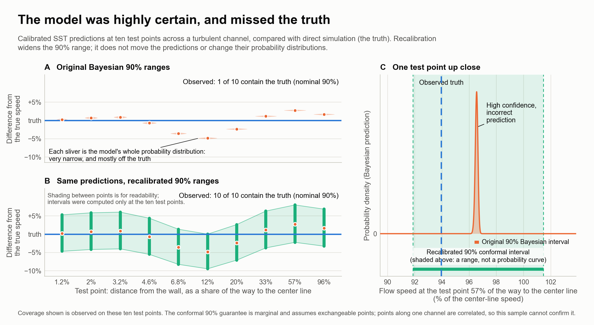
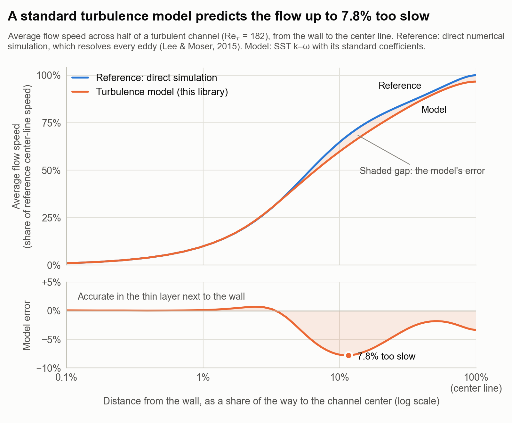
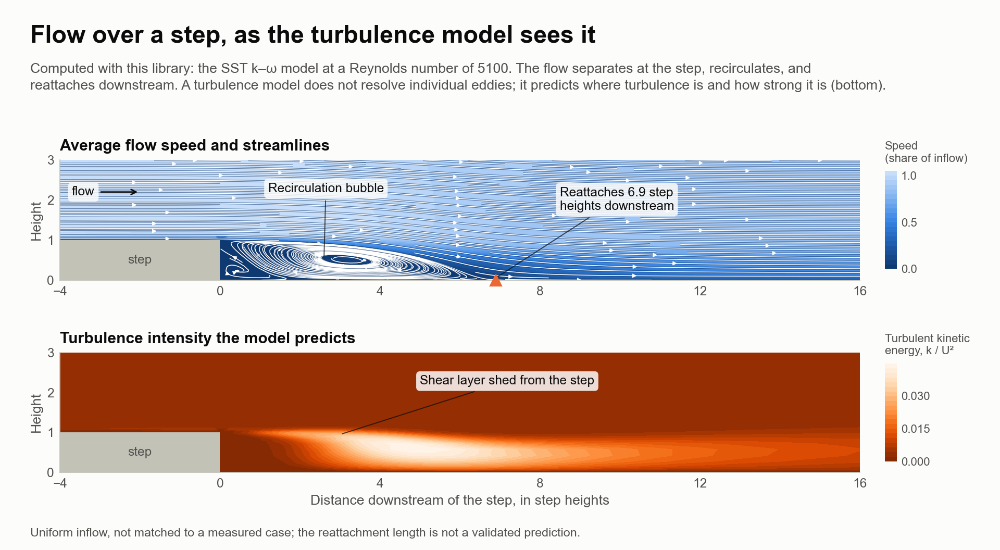

# bayesian-rans-uq

Bayesian calibration of Reynolds-averaged Navier–Stokes (RANS) turbulence models tends to produce overconfident predictions: the posterior concentrates on a single best-fitting set of closure coefficients, and the reported uncertainty is too narrow for flow types outside the calibration set. This library provides an end-to-end framework for performing such calibrations and assessing their reliability. It couples a finite-volume RANS solver with observation operators and a statistical layer for sampling, importance weighting and predictive scoring. Solver convergence is checked for every evaluation, and failed solves are excluded from the posterior, so that numerical error is not mistaken for model uncertainty.

<p align="center">
<picture>
  <source media="(prefers-color-scheme: dark)" srcset="docs/figures/calibration_coverage_dark.png">
  
</picture>
</p>

*The SST coefficients a1 and β\* are calibrated with this library against direct numerical simulation of a turbulent channel at Re<sub>τ</sub> = 182 (Lee and Moser, 2015), with the simulation's statistical uncertainty (median 0.14% of the local speed) as the measurement noise. Thirty points across the channel form three groups of ten: one fits the coefficients, one sets a split-conformal recalibration, and one is used only for testing. The fit is close, yet the nominal 90% ranges contain the true speed at only 1 of the 10 test points, because the model's own error (up to 4.9%) is far larger than the noise the calibration assumes. The recalibrated ranges contain it at all 10; ten correlated points along one channel cannot confirm 90% coverage, which would need independent flow cases. The figure is generated by [docs/figures/calibration_coverage.py](docs/figures/calibration_coverage.py).*

<p align="center">
<picture>
  <source media="(prefers-color-scheme: dark)" srcset="docs/figures/calibration_distributions_dark.png">
  
</picture>
</p>

*Why the standard ranges miss. A: each test point's posterior predictive distribution (the exact mixture of the posterior draws and the measurement noise), drawn on one shared density scale. B: the same predictions with the split-conformal 90% intervals, which widen the range without moving the predictions or changing their distributions. C: the distribution at one test point, with the observed truth and both 90% intervals. Coverage is observed on these ten points; the conformal guarantee is marginal and assumes exchangeable points, which correlated points along one channel need not be.*

<details>
<summary>Method details and values at the held-out points</summary>

The likelihood is sharply peaked, so the calibration proceeds in three steps: 24 uniform draws over a1 ∈ [0.28, 0.34] and β\* ∈ [0.084, 0.096] locate the high-likelihood region, a pattern search finds the best fit (a1 ≈ 0.324, β\* ≈ 0.0968), and the posterior is formed from 48 uniform draws in a small box centered there, with the highest-weight draw inside the box. The effective sample size is 2.5, and the spread in the coefficients contributes at most 16% of the predictive variance at any point. All 136 solves converged.

| Distance from the wall (share of the way to the center) | True speed | Standard 90% range | Recalibrated 90% range |
|---|---|---|---|
| 1.2% | 11.6% | 11.5–11.6% (contains) | 11.0–12.2% (contains) |
| 2.0% | 20.0% | 20.1–20.2% | 19.2–21.2% (contains) |
| 3.2% | 30.1% | 30.3–30.4% | 28.9–31.9% (contains) |
| 4.6% | 40.6% | 40.2–40.5% | 38.4–42.4% (contains) |
| 6.8% | 53.3% | 51.3–51.6% | 48.9–54.1% (contains) |
| 11.6% | 68.6% | 65.2–65.4% | 62.1–68.6% (contains) |
| 19.7% | 78.9% | 76.9–77.2% | 73.3–80.9% (contains) |
| 33.2% | 86.4% | 87.2–87.5% | 83.1–91.8% (contains) |
| 56.9% | 93.9% | 96.4–96.7% | 91.9–101.5% (contains) |
| 95.8% | 99.9% | 101.4–101.8% | 96.7–106.8% (contains) |

Speeds are shares of the reference center-line speed.

</details>

## Source of the overconfidence

The calibrated ranges are too narrow because adjusting a1 and β\* cannot remove the model's error: even the best fit misses the reference by up to 4.9%, while the calibration treats the data as accurate to about 0.1%. The error is visible before any calibration; with its standard coefficients, SST underpredicts the speed across most of the channel:

<p align="center">
<picture>
  <source media="(prefers-color-scheme: dark)" srcset="docs/figures/channel_profile_dark.png">
  
</picture>
</p>

*The SST k–ω model at its standard coefficients, computed with this library, compared with direct numerical simulation of the same channel flow (Lee and Moser, J. Fluid Mech. 774, 2015). The two agree in the thin layer next to the wall; farther out, the model underpredicts the speed by up to 7.8%. Refining the mesh from 64 to 128 cells changes the computed speed by at most 0.22% of the center-line value, so the gap is model error rather than numerical error, and it is the kind of error that calibrated predictions must account for. The figure is generated by [docs/figures/channel_profile.py](docs/figures/channel_profile.py).*

<details>
<summary>Values plotted in the figure</summary>

| Distance from the wall (share of the way to the center) | Reference speed | Model speed | Model error |
|---|---|---|---|
| 0.5% | 5.4% | 5.4% | 0.0% |
| 2.0% | 20.0% | 20.1% | +0.6% |
| 5.1% | 44.0% | 42.6% | −3.2% |
| 11.6% | 68.6% | 63.3% | −7.8% |
| 29.6% | 84.8% | 81.8% | −3.5% |
| 60.0% | 94.7% | 92.9% | −1.9% |
| 99.2% | 100.0% | 96.7% | −3.3% |

Speeds are shares of the reference center-line speed; the model error is relative to the local reference speed.

</details>

## Capabilities

<p align="center">
<picture>
  <source media="(prefers-color-scheme: dark)" srcset="docs/figures/step_flow_dark.png">
  
</picture>
</p>

*Flow over a backward-facing step at Re<sub>h</sub> = 5100, computed with this library using the SST k–ω model. Top: average flow speed and streamlines, showing separation at the step, a recirculation bubble and reattachment 6.9 step heights downstream. Bottom: the turbulent kinetic energy the model predicts, concentrated in the shear layer shed from the step; a RANS model represents turbulence by this intensity rather than by individual eddies. The inflow is uniform and not matched to a measured case, so the reattachment length is not a validated prediction. The figure is generated by [docs/figures/step_flow.py](docs/figures/step_flow.py).*

- A steady two-dimensional incompressible flow solver based on the SIMPLE algorithm, with Rhie–Chow pressure–velocity coupling and the SST k–ω turbulence model.
- Observation operators that map a solution to measurable quantities: velocity and pressure at arbitrary points in the domain, reconstructed linearly from cell-centered values, and wall pressure and skin-friction coefficients, each paired with a Gaussian likelihood.
- An explicit convergence status for every evaluation. Failed and iteration-capped solves are retained and labelled, and are excluded from the posterior.
- Parallel batch evaluation of coefficient samples on shared-memory worker threads, with bitwise-identical results across worker counts and sample orderings.
- A statistical layer for importance-sampling calibration: reproducible prior designs with stable sample identifiers and seeded random streams, likelihood-based importance weights, posterior resampling, and predictive assessment by the continuous ranked probability score (CRPS), split-conformal prediction intervals and rank histograms.
- Experimental components: steady-state sensitivities of observations with respect to the SST coefficients, and a density-based compressible solver (HLLC fluxes with MUSCL reconstruction) in `extras/`.

## Repository structure

```
core/                mesh, fields, linear solvers, SST model, observations
rans-uq/             SIMPLE solver, forward models, sensitivities, batches
  python/            pybind11 bindings and the Python package
extras/
  compressible/      density-based solver and an experimental low-Mach solver
tests/               test registration, reference solutions, check scripts
cmake/               build and install configuration
docs/                installation details and figure scripts
```

The Python package and the CMake targets are named `cfdr`.

## Installation

The library requires Python 3.11 or later, a C++17 compiler and CMake 3.21 or later. The Python package is installed with:

```sh
python3 -m venv .venv
. .venv/bin/activate
CMAKE_BUILD_PARALLEL_LEVEL=2 python -m pip install .
```

The C++ libraries alone are installed with:

```sh
cmake -S . -B build/native -DCMAKE_BUILD_TYPE=Release \
  -DBUILD_TESTING=OFF -DCFDR_BUILD_PYTHON=OFF \
  -DCMAKE_INSTALL_PREFIX="$PWD/build/prefix"
cmake --build build/native --parallel 2
cmake --install build/native
```

Further details are given in [docs/installation.md](docs/installation.md).

## Example

The following example performs a complete calibration on a deliberately small problem: a 3×4-cell channel, a single synthetic velocity measurement and the SST coefficients a1 and β*. It runs in a few seconds.

```python
import numpy as np
from cfdr import _core as c
from cfdr import statistics as stats

# A small channel with one synthetic measurement: u = 0.8 ± 0.1 at (0.5, 0.4).
mesh = c.Mesh.make_channel_2d(3, 4, 1.0, 1.0)
mesh.compute_wall_distance()
observations = c.ObservationOperator()
observations.add_velocity_profile(c.Vec3(0.5, 0.4, 0.0), 0, 0.8, 0.1)
boundaries = c.FlowBoundaryConditions.channel_defaults(mesh, 1.0, 0.02, 3.0)
settings = c.SolverSettings()
settings.verbose = False
settings.max_iterations = 5000
settings.convergence_tol = 1e-5
batch = c.ForwardBatch(
    mesh, c.InferenceParameterSet.a1_betaStar(), observations, boundaries, 0.01, settings
)

# Uniform prior draws for (a1, beta*), solved on two worker threads.
prior = stats.independent_uniform_design(range(24), [0.30, 0.085], [0.34, 0.095], root_seed=1)
evaluations = stats.evaluate_batch(prior, batch, workers=2)

# Importance weights, then a posterior predictive for the measured velocity.
weights = stats.posterior_weights(evaluations)
theta = np.array([record.theta for record in evaluations.records])
print("posterior mean of (a1, beta*):", np.average(theta, axis=0, weights=weights))

posterior = stats.resample_posterior(evaluations, range(1000, 1024), root_seed=1)
predicted = stats.predictive_summary(
    stats.evaluate_batch(posterior, batch, workers=2), root_seed=1, observation_sigma=(0.1,)
)
print(f"predicted u: {predicted.latent_mean[0]:.4f} ± {np.sqrt(predicted.total_variance[0]):.4f}")
print(f"  of which from the coefficients: ± {np.sqrt(predicted.latent_variance[0]):.1e}")
```

Expected output:

```
Channel2D mesh: 3x4 (12 cells, 31 faces)
posterior mean of (a1, beta*): [0.31792365 0.0896799 ]
predicted u: 1.2116 ± 0.1000
  of which from the coefficients: ± 6.9e-07
```

The predicted velocity (1.21) lies four standard deviations from the measurement (0.8). On a mesh this coarse, a1 and β* have a negligible effect on the observed velocity, so the importance weights remain uniform and the posterior coincides with the prior; nearly all of the reported ±0.10 is the assumed measurement noise. Nothing in the posterior indicates that no coefficient values can reproduce the data. This is the overconfidence problem in miniature, and it motivates reporting the predictive variance by source, as the predictive summary does.

If any solve fails to converge, `posterior_weights` raises an error that reports the number of failures rather than silently discarding them.

C++ applications link the installed CMake targets:

```cmake
cmake_minimum_required(VERSION 3.21)
project(cfdr_cmake_consumer LANGUAGES CXX)
find_package(cfdr 0.1 CONFIG REQUIRED)
add_executable(cmake_consumer main.cpp)
target_link_libraries(cmake_consumer PRIVATE cfdr::incompressible cfdr::dbns)
enable_testing()
add_test(NAME cmake_consumer COMMAND cmake_consumer)
```

A complete example is provided in [tests/install-consumer](tests/install-consumer/main.cpp). After the C++ installation above, it is built and run with:

```sh
cmake -S tests/install-consumer -B build/example \
  -DCMAKE_PREFIX_PATH="$PWD/build/prefix"
cmake --build build/example --parallel 2
ctest --test-dir build/example --output-on-failure
```

## Current work

- The SIMPLE solver has no non-orthogonal correction, so its accuracy on curved meshes, such as periodic-hill meshes finer than 60×40 cells, has not been established.
- The backward-facing step and periodic-hill cases have no matched, grid-converged reference comparison, so they have not yet been validated.
- The calibration layer has no Markov chain Monte Carlo sampler, so posteriors are formed by importance weighting of independent prior draws.
- The steady-state sensitivity method has been verified on a single small case, so it remains experimental.
- The density-based solver in `extras/` uses a simplified SST diffusion model, so its turbulent and implicit paths remain experimental. The low-Mach solver omits general compressible energy terms.
- The solvers run on a single node, with thread-level parallelism for batch evaluations. Distributed-memory parallelization with MPI is in development, beginning with ensemble batches distributed across ranks and followed by domain-decomposed SIMPLE.
